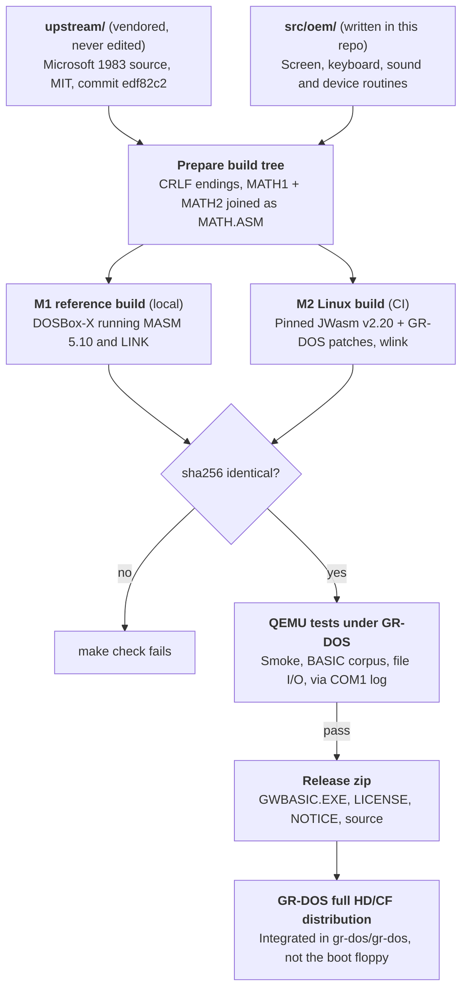

# GW-BASIC Initial Implementation — Design

2026-11-18 · Draft for review ([tracking issue #1](https://github.com/gr-dos/gw-basic/issues/1))

## Background

We are not writing a new interpreter. [Issue #1](https://github.com/gr-dos/gw-basic/issues/1) asks us to build Microsoft's 1983 GW-BASIC assembly source into a reproducible, license-compliant 8086 `GWBASIC.EXE`. That executable ships in GR-DOS's full hard-disk/CF distribution, not the frozen 360 KB boot floppy.

- **This repo** (`gr-dos/gw-basic`, branch `graham/impl`) holds only a README today.
- **Upstream source:** [microsoft/GW-BASIC](https://github.com/microsoft/GW-BASIC) is MIT, archived, and read-only. It has 38 `.ASM` files and 4 headers (`OEM.H`, `IBMRES.H`, `BINTRP.H`, `GIO86U`) but, in its own words, "no build scripts, makefiles, or tools". Some OEM-specific routines are also missing.
- **Prior art:** [TK Chia's restoration](https://codeberg.org/tkchia/GW-BASIC) builds with JWasm, JWlink, AWK and GNU Make, producing `GWBASIC.EXE` and `GWBASICA.EXE`. It rewrote the missing OEM layer (`OEM.ASM`, `OEMEV.ASM`, `OEMSND.ASM`) "mainly from scratch". Its latest release is 20261005, described as "mostly working". Serial I/O is still stubbed, and light pen, joystick and printer are untested.
- **GR-DOS precedent:** [gr-dos/gr-dos](https://github.com/gr-dos/gr-dos) already proved the approach we want to reuse. Its M1 milestone was a MASM 5.10 reference build under DOSBox-X. M2 was a Linux build with pinned, patched JWasm v2.20 and `wlink` that matches M1 byte for byte ([m2-jwasm.md](https://github.com/gr-dos/gr-dos/blob/main/docs/m2-jwasm.md)).

## Goals and non-goals

Success is one MIT-clean `GWBASIC.EXE` that anyone can rebuild bit for bit on Linux and that runs under GR-DOS on an 8088.

**Goals**

1. Vendor Microsoft's source unmodified, pinned to upstream commit `edf82c2`, with its MIT notice and a provenance record in the style of GR-DOS `docs/provenance.md`.
2. Supply the missing OEM layer (IBM PC screen, keyboard, sound, graphics and device glue) as separately licensed, clearly attributed files.
3. Build with GR-DOS's pinned JWasm v2.20 plus its patches and Open Watcom `wlink`. The build must be deterministic, checked by a committed sha256 manifest.
4. Use 8086/8088 instructions only, and run under GR-DOS in QEMU. Run a smoke test on real PC/XT hardware later.
5. Document how this 1983 dialect differs from later GW-BASIC releases (3.2x).
6. Hand GR-DOS a release zip with the binary, `LICENSE`, `NOTICE` and the source, for its full distribution and HELP inventory.

**Non-goals**

- Feature parity with GW-BASIC 3.23. Subdirectory paths, `TIMER`, `CHDIR` and similar features are a later milestone, if we do them at all.
- A spot on the 360 KB boot floppy.
- Changing the BASIC language or adding features beyond what is needed to run.
- Byte-identity with a historical IBM or Microsoft binary. No 1983 build exists to compare against, so our own MASM build is the reference.

## Build architecture

We copy GR-DOS's approach. One build uses the period tools as a reference, and a second build with open tools must match it byte for byte.

The MASM build exists only to prove the JWasm build correct. CI runs only the Linux build and the QEMU tests.

| Path | Holds |
| --- | --- |
| `upstream/` | Microsoft source at `edf82c2`, byte for byte, with its `LICENSE` |
| `src/oem/` | Our OEM modules, MIT, with per-file headers |
| `scripts/` | `prepare-tree`, `reference-build`, `fetch-jwasm`, `fetch-watcom`, `run-tests` (ported from GR-DOS where possible) |
| `tests/` | `.BAS` corpus and golden output |
| `docs/` | Provenance, dialect notes, `reference-build.sha256` |
| `Makefile` | `make` builds `build/GWBASIC.EXE`, `make check` compares builds, `make test` runs QEMU, `make dist` makes the zip |

## Source gaps and the OEM layer

The main engineering work is filling the OEM gap. A first scan of upstream `edf82c2` found 219 symbols declared `EXTRN` but never defined as a label, `PROC`, data item or equate. This is a rough text scan, so some symbols may be produced by macros we did not expand.

| Group | Count | Examples | Likely source |
| --- | --- | --- | --- |
| Hardware routines and state | ~151 | `SCROUT` `SCRINP` `MAPXYC` `SETC` `GWINI` `GWTERM` `KEYINP` `DONOTE` `RDPEN` `INICOM` `CSRX` `LINLEN` | Missing OEM modules: must be written |
| Token constants | 51 | `$PRINT` `$GOTO` `$ELSE` `$_COM1` | Probably macro-generated from `IBMRES.ASM`; to confirm |
| Error entry points | 17 | `DERBFM` `DERFNF` `DERIOE` | Probably macro-generated in `GWMAIN.ASM`; to confirm |

We will write our own OEM modules from the upstream interface, guided by the hooks in `OEM.H`, `GIO86U` and `MSDOSU`. They will target IBM PC BIOS calls (`INT 10h`, `16h`, `17h`, `14h`) on CGA and MDA.

TK Chia's `OEM.ASM`, `OEMEV.ASM` and `OEMSND.ASM` are the obvious shortcut. The fork's README says all files are MIT, but its `LICENSE` names only Microsoft, and its vendored JWasm and JWlink carry their own licenses. Until the maintainer confirms that the new files are MIT, we use the fork as a reference only. That means reading it to understand the interface, not copying its code.

The OEM files go in `src/oem/`, separate from the untouched `upstream/` tree, so `NOTICE` can say exactly who wrote what.

## Testing strategy

Every test runs headless in CI except real-hardware runs. A test passes when an expected marker arrives on COM1, the same way GR-DOS's `reference-boot` works.

| Layer | What it checks | How |
| --- | --- | --- |
| Reproducibility | Two clean builds give identical bytes; JWasm matches the MASM reference | `make check` compares against `docs/reference-build.sha256` |
| 8086 only | No 186+ opcodes in `GWBASIC.EXE` | Disassemble and scan, plus a QEMU run with an 8086-limited CPU model if one is available |
| Interpreter smoke | Starts, prints banner, `PRINT 2+2`, exits with `SYSTEM` | GR-DOS floppy image + `AUTOEXEC.BAT` running `GWBASIC TEST.BAS`, output to `COM1` |
| Language corpus | Arithmetic (single/double), strings, `GOSUB`, `ON ERROR`, `DEF FN`, arrays | `tests/*.BAS` with golden output files, diffed |
| File I/O | `SAVE`/`LOAD` (tokenised and `,A`), `OPEN`/`PRINT #`/`INPUT #`, random files | Corpus programs that write and read back from disk |
| Screen and sound | `SCREEN 1/2`, `PSET`, `LINE`, `PLAY`, `SOUND` | Screenshot compare in QEMU; manual on hardware |
| Hardware | IBM PC/XT or clone, CGA/MDA | Manual checklist each release |

The corpus can borrow programs from period books that are freely licensed, but each one needs its provenance recorded.

## Milestones

The milestones follow GR-DOS's M0 to M2 sequence, then add the run, package and hardware steps from issue #1. M1 carries the most risk because it needs the whole OEM layer before anything boots.

| Milestone | Work | Gate: done when |
| --- | --- | --- |
| **M0** Provenance and gap analysis | Vendor upstream, list missing symbols | Provenance and gap list reviewed; TK Chia license answer recorded |
| **M1** OEM layer + MASM reference | Write `src/oem/`, build under DOSBox-X | `GWBASIC.EXE` starts and prints its banner; two clean MASM builds are identical |
| **M2** Linux build, byte-identical | JWasm + wlink, `make check` | `make check`: sha256 matches the M1 reference |
| **M3** Runs on GR-DOS | QEMU smoke, BASIC corpus, file I/O | `make test` green in CI: smoke, corpus, file I/O |
| **M4** Package and integrate | Release zip, PR to `gr-dos/gr-dos` | Zip merged into the GR-DOS full distribution; listed in its HELP inventory |
| **M5** Hardware + dialect notes | PC/XT smoke test, `docs/dialect.md` | Smoke test passes on a real PC/XT; issue #1 acceptance met |

M0 is small enough to start on `graham/impl` now. It covers vendoring `upstream/`, writing `docs/provenance.md`, committing the symbol-gap scan as a script, and sending the license question to TK Chia.

## Open questions

- [ ] Reuse TK Chia's OEM files or write our own? Ask the maintainer to confirm in writing that `OEM.ASM`, `OEMEV.ASM` and `OEMSND.ASM` are MIT.
- [ ] How should we vendor upstream: a git submodule, a subtree, or a plain copy with its tree hash recorded? GR-DOS used a plain copy.
- [ ] Do the `$` token and `DER` error symbols really come from macros? Expanding `IBMRES.ASM` and `GWMAIN.ASM` with JWasm `-EP` would settle it.
- [ ] Ship one binary or two? TK Chia ships `GWBASIC.EXE` plus a `GWBASICA.EXE` with post-1983 extras. Our proposal is one binary for v1.
- [ ] Where does the MASM 5.10 reference toolchain come from? Can we reuse GR-DOS's `TOOLS` binaries and DOSBox-X script?
- [ ] Which GR-DOS kernel gaps will GW-BASIC hit? Track candidates such as the `INT 21h` calls used by `MSDOSU` in `gr-dos/gr-dos` once smoke tests run.
- [ ] Should the version banner say GR-DOS, the way COMMAND.COM's branding patch does?
