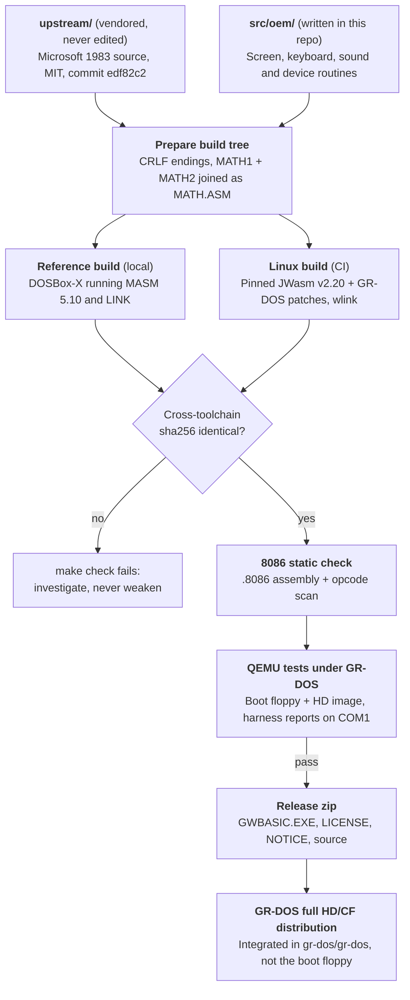

# GW-BASIC Initial Implementation — Design

2026-11-18 · Draft for review ([tracking issue #1](https://github.com/gr-dos/gw-basic/issues/1))

## Background

We are not writing a new interpreter. [Issue #1](https://github.com/gr-dos/gw-basic/issues/1) asks us to build Microsoft's 1983 GW-BASIC assembly source into a reproducible, license-compliant 8086 `GWBASIC.EXE`. That executable ships in GR-DOS's full hard-disk/CF distribution, not the frozen 360 KB boot floppy.

- **This repo** (`gr-dos/gw-basic`) holds the vendored source, provenance and the M0 analysis tools.
- **Upstream source:** [microsoft/GW-BASIC](https://github.com/microsoft/GW-BASIC) is MIT, archived, and read-only. It has 35 `.ASM` files (34 modules), 3 `.H` files and 2 extensionless include files (`GIO86U`, `MSDOSU`) but, in its own words, "no build scripts, makefiles, or tools". Some OEM-specific routines are also missing.
- **Prior art:** [TK Chia's restoration](https://codeberg.org/tkchia/GW-BASIC) builds with JWasm, JWlink, AWK and GNU Make, producing `GWBASIC.EXE` and `GWBASICA.EXE`. It rewrote the missing OEM layer (`OEM.ASM`, `OEMEV.ASM`, `OEMSND.ASM`) "mainly from scratch". Its latest release is 20261005, described as "mostly working". Serial I/O is still stubbed, and light pen, joystick and printer are untested.
- **GR-DOS precedent:** [gr-dos/gr-dos](https://github.com/gr-dos/gr-dos) already proved the approach we want to reuse. Its M1 milestone was a MASM 5.10 reference build under DOSBox-X. M2 was a Linux build with pinned, patched JWasm v2.20 and `wlink` that matches M1 byte for byte ([m2-jwasm.md](https://github.com/gr-dos/gr-dos/blob/main/docs/m2-jwasm.md)).

## Goals and non-goals

Success is one MIT-clean `GWBASIC.EXE` that anyone can rebuild bit for bit on Linux and that runs under GR-DOS on an 8088.

**Goals**

1. Vendor Microsoft's source unmodified, pinned to upstream commit `edf82c2`, as a plain copy with its commit and tree hashes, its MIT notice and a provenance record in the style of GR-DOS `docs/provenance.md`.
2. Supply the missing OEM layer (IBM PC screen, keyboard, sound, graphics and device glue) as independently written, separately licensed, clearly attributed files.
3. Build with GR-DOS's pinned JWasm v2.20 plus its patches and Open Watcom `wlink`. The build must be deterministic, checked by a committed sha256 manifest.
4. Use 8086/8088 instructions only: checked statically at build time, then confirmed by a run on a real 8088.
5. Run under GR-DOS in QEMU, in the disk layout the full distribution uses.
6. Document how this 1983 dialect differs from later GW-BASIC releases (3.2x).
7. Hand GR-DOS a release zip with the binary, `LICENSE`, `NOTICE` and the source, for its full distribution and HELP inventory.

**Non-goals**

- Feature parity with GW-BASIC 3.23. Subdirectory paths, `TIMER`, `CHDIR` and similar features are a later milestone, if we do them at all.
- A spot on the 360 KB boot floppy.
- Changing the BASIC language or adding features beyond what is needed to run.
- Rebranding the interpreter. The original GW-BASIC banner stays; GR-DOS identification goes in package metadata (see Decisions).
- Byte-identity with a historical IBM or Microsoft binary. No 1983 build exists to compare against, so our own MASM build is the reference.

## Build architecture

We copy GR-DOS's approach. One build uses the period tools as a reference, and a second build with open tools must match it byte for byte.

The MASM build exists only to prove the JWasm build correct. CI runs only the Linux build, the 8086 check and the QEMU tests.

| Path | Holds |
| --- | --- |
| `upstream/` | Microsoft source at `edf82c2`, byte for byte, with its `LICENSE`; commit and tree hashes in `docs/provenance.md` |
| `src/oem/` | Our OEM modules, MIT, with per-file headers |
| `scripts/` | `prepare-tree`, `fetch-grdos`, `fetch-jwasm`, `fetch-watcom`, `check-upstream`, `symbol-report` (M0); `reference-build`, `check-8086`, `run-tests` (later) |
| `tests/` | `.BAS` corpus, golden output, and the DOS-side harness |
| `docs/` | `provenance.md`, `symbols.md` (M0); feature matrix, dialect notes, `reference-build.sha256` (later) |
| `Makefile` | `make` builds `build/GWBASIC.EXE`, `make check` runs both reproducibility checks, `make test` runs QEMU, `make dist` makes the zip |

### Reproducibility checks

These are two separate checks, reported separately by `make check`:

1. **Determinism.** Two clean builds with the same toolchain give identical bytes. This applies to both the MASM build and the Linux build.
2. **Cross-toolchain identity.** The JWasm/wlink `GWBASIC.EXE` is byte-identical to the MASM/LINK reference. This is the initial and preferred acceptance gate, as it was in GR-DOS.

If toolchain metadata or segment layout makes check 2 impossible, we do not quietly weaken it. We investigate first, as GR-DOS did with its JWasm patches. If a difference cannot be removed, we write an explicit equivalence policy (for example an OMF- or map-level comparison listing every allowed difference) and get it reviewed before `make check` changes.

## Source gaps and the OEM layer

The main engineering work is filling the OEM gap. M0 measured it: after macro expansion, upstream `edf82c2` leaves **63 routines** undefined, and no data. [`docs/symbols.md`](symbols.md) lists them, generated by `make symbols` and checked against a trial link by `make check`.

| Subsystem | Routines | Examples |
| --- | --- | --- |
| Graphics | 24 | `MAPXYC` `SETC` `READC` `STOREC` `SCALXY` `SCANL` |
| IBM PC statements in `GWSTS` | 11 | `SETCLR` `DONOTE` `RDPEN` `RDSTIK` `POLLEV` |
| Screen and text editor | 10 | `SCROUT` `SCRINP` `SCROLL` `CLRSCN` `SWIDTH` |
| Initialisation and core | 6 | `GWINI` `SEGINI` `GETHED` `PEKFLT` |
| Keyboard | 5 | `KEYINP` `INKMAP` `CSRDSP` |
| Serial (COM) | 5 | `INICOM` `SNDCOM` `RECCOM` |
| Printer and device I/O | 2 | `SNDLPT` `GWTERM` |

The first draft of this design counted 219 symbols from a text scan. The other 156 turned out to be generated by macros: the token values (`$PRINT`), the error entry points (`DERBFM`) and the RAM variables (`CSRX`). [`docs/provenance.md`](provenance.md) has the details.

To make upstream assemble at all, `scripts/prepare-tree` applies seven named, logged rewrite rules to a copy in `build/src`, chiefly renaming symbols that later assemblers reserve. `upstream/` is never edited. The rules are meant to change only spelling, never generated code. M1's MASM build and M2's byte comparison verify that.

**Licensing decision.** We write our own OEM modules from the upstream interface, guided by the hooks in `OEM.H`, `GIO86U` and `MSDOSU`. They target IBM PC BIOS calls (`INT 10h`, `16h`, `17h`, `14h`) on CGA and MDA.

TK Chia's `OEM.ASM`, `OEMEV.ASM` and `OEMSND.ASM` are an obvious shortcut. The fork's README says all files are MIT, but its `LICENSE` names only Microsoft, and its vendored JWasm and JWlink carry their own licenses. We will ask the maintainer to clarify, but the project does not wait for an answer. Until rights are established, the fork is a technical reference only: we read it to understand the interface and do not copy its code. If the maintainer later confirms MIT terms, reusing parts of it becomes a separate, reviewed change.

The OEM files go in `src/oem/`, separate from the untouched `upstream/` tree, so `NOTICE` can say exactly who wrote what.

## Testing strategy

Every test runs headless in CI except real-hardware runs. A test passes when an expected marker arrives on COM1, the same way GR-DOS's `reference-boot` works. **The markers never depend on GW-BASIC's own serial support,** which may stay stubbed for a long time.

### Harness

1. Each `.BAS` test writes its results to a file with `OPEN "O",#1,"RESULT.TXT"` and ends with `SYSTEM`.
2. A DOS batch harness (`RUN.BAT`) runs each test in turn, then sends `RESULT.TXT` and begin/end markers to COM1 using DOS itself (for example `TYPE RESULT.TXT > AUX`).
3. On the host, `scripts/run-tests` reads the COM1 log and diffs each result against its golden file.

GW-BASIC writes to the screen through BIOS, so DOS `>` redirection of the interpreter's own output probably captures nothing. The harness therefore relies on result files. Before we depend on it, M1 checks that `SYSTEM` returns cleanly to the batch file and that files written by the interpreter are fully flushed.

### Disk layout

Tests use the layout the full distribution ships with. QEMU boots the frozen 360 KB GR-DOS floppy unchanged as `A:`. A separate HD/CF image is attached as `C:`, holding `GWBASIC.EXE`, the `.BAS` tests and `RUN.BAT`. Nothing assumes the boot floppy can start GW-BASIC by itself. How `RUN.BAT` gets started is decided in M1: either a test-only copy of the floppy whose `AUTOEXEC.BAT` only calls `C:\RUN.BAT`, or booting the full distribution's HD image directly if GR-DOS supports that.

### 8086/8088 validation

- **Static gate (CI).** Every module is assembled under `.8086`, so JWasm rejects 186+ instructions at source level. In addition, `scripts/check-8086` disassembles `GWBASIC.EXE` and scans the code segments for post-8086 opcodes, using the linker map to keep data out of the scan. Disassemblers can misread data as code and miss hand-encoded `DB` instructions, so every hit, and every `DB`-encoded instruction in the source, is reviewed and recorded in an allowlist with its reason.
- **Real 8088 gate (M5).** A real 8088 PC/XT, or a clone with a true 8088, runs the smoke test and the corpus.
- QEMU provides functional coverage only. We do not rely on QEMU or any optional 8086-limited CPU model to catch bad opcodes.

### Test layers

| Layer | What it checks | How |
| --- | --- | --- |
| Determinism | Two clean builds with one toolchain are identical | `make check`, part 1 |
| Cross-toolchain identity | JWasm/wlink output matches the MASM/LINK reference | `make check`, part 2, against `docs/reference-build.sha256` |
| 8086 only | No post-8086 instructions | `.8086` assembly + `scripts/check-8086` |
| Interpreter smoke | Starts, `PRINT 2+2` to a result file, exits with `SYSTEM` | Floppy `A:` + HD image `C:`, harness reports on COM1 |
| Language corpus | Features marked "in" in the feature matrix | `tests/*.BAS` with golden output files, diffed |
| File I/O | `SAVE`/`LOAD` (tokenised and `,A`), `OPEN`/`PRINT #`/`INPUT #`, random files | Corpus programs that write and read back from disk |
| Screen and sound | `SCREEN 1/2`, `PSET`, `LINE`, `PLAY`, `SOUND` | Screenshot compare in QEMU; manual on hardware |
| Hardware | Real 8088 PC/XT or clone, CGA/MDA | Manual checklist each release |

The corpus can borrow programs from period books that are freely licensed, but each one needs its provenance recorded.

### Defect triage

When tests expose a problem, we first decide whose it is:

- **A GR-DOS kernel incompatibility** (for example an `INT 21h` call from `MSDOSU` that GR-DOS mishandles) is filed in `gr-dos/gr-dos` and cross-linked to #1.
- **A GW-BASIC OEM defect** is fixed here.

A test that fails because of a kernel issue is marked with that issue's number instead of being worked around in the OEM layer.

## Milestones

The milestones follow GR-DOS's M0 to M2 sequence, then add the run, package and hardware steps from issue #1. M1 carries the most risk, so it is split into four checkpoints that each end in something runnable.

| Milestone | Work | Gate: done when |
| --- | --- | --- |
| **M0** Provenance and gap analysis | Vendor upstream; `scripts/symbol-report`; ask TK Chia about licensing | Provenance reviewed; `docs/symbols.md` committed and reproducible; clarification request recorded with the current licensing decision (no reply needed) |
| **M1a** Screen + keyboard | Text-mode screen and keyboard OEM routines; MASM reference build stood up | Interpreter reaches the `Ok` prompt and runs `PRINT 2+2` interactively; MASM builds are deterministic |
| **M1b** DOS and file glue | File and device glue; the test harness | Harness smoke test passes: result file written, `SYSTEM` returns to `RUN.BAT` |
| **M1c** Graphics | `SCREEN`, `PSET`, `LINE`, `CIRCLE`, `PAINT` on CGA | Graphics corpus programs match reference screenshots |
| **M1d** Sound and devices | `SOUND`, `PLAY`, printer, serial stubs | Remaining symbols in `docs/symbols.md` are resolved or listed as stubs |
| **M2** Linux build, byte-identical | JWasm + wlink; `make check`; 8086 static gate | Both reproducibility checks pass, or an equivalence policy is reviewed; `check-8086` is clean |
| **M3** Runs on GR-DOS | QEMU corpus against the feature matrix | `make test` green in CI; kernel issues filed in `gr-dos/gr-dos` |
| **M4** Package and integrate | Release zip, PR to `gr-dos/gr-dos` | Zip merged into the GR-DOS full distribution; listed in its HELP inventory |
| **M5** Hardware + dialect docs | Real 8088 run; user-facing `docs/dialect.md` | Smoke test and corpus pass on a real 8088; dialect docs complete; issue #1 acceptance met |

**Feature matrix.** A minimal 1983 feature matrix (`docs/features.md`) is started during M1 and must exist before M3. It lists each statement and function as in, out, or stubbed. The M3 corpus tests exactly the features marked "in", and M5 turns the matrix into the user-facing dialect documentation.

**M0 status:** done in [#3](https://github.com/gr-dos/gw-basic/pull/3) except for sending the clarification request to TK Chia (drafted in `docs/provenance.md`). This covers the vendored `upstream/` with tree-hash check, `docs/provenance.md`, `scripts/prepare-tree`, the toolchain pinned through GR-DOS, `docs/symbols.md` and CI.

## Decisions

These were open questions, settled in review of [#2](https://github.com/gr-dos/gw-basic/pull/2):

- **Vendoring:** a plain copy of upstream with its commit and tree hashes and a provenance record, as in GR-DOS. No submodule or subtree.
- **Binaries:** one `GWBASIC.EXE` to start with. No `GWBASICA.EXE` variant.
- **Banner:** keep the original GW-BASIC banner. GR-DOS branding goes in package metadata, or in an optional build identifier that is clearly separate from the original banner. It is never a functional patch.
- **TK Chia code:** we write our own OEM layer. We ask for clarification, but nothing blocks on the reply, and we copy nothing until rights are established.

## Open questions

- [x] ~~Do the `$` token and `DER` error symbols come from macros?~~ Yes, along with the RAM variables (M0, `docs/symbols.md`).
- [ ] Where does the MASM 5.10 reference toolchain come from? Can we reuse GR-DOS's `TOOLS` binaries and DOSBox-X script?
- [ ] How should `RUN.BAT` start in tests: a test-only floppy copy, or booting the full distribution's HD image (see Disk layout)?
- [ ] Which GR-DOS kernel gaps will GW-BASIC hit? M3 will show us; see Defect triage.
